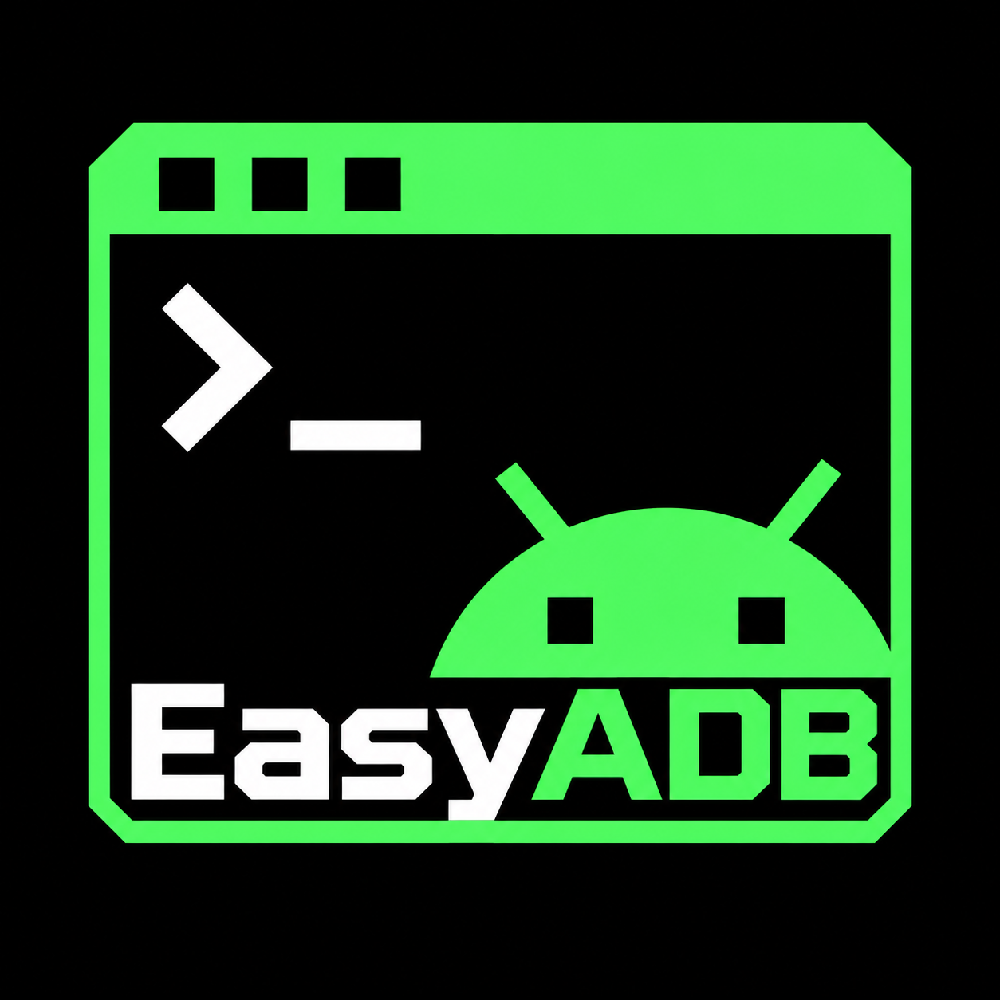

<a id="readme-top"></a>

<p align="center">
  <a href="README.md">English</a>
</p>

[![Contributors][contributors-shield]][contributors-url]
[![Forks][forks-shield]][forks-url]
[![Stargazers][stars-shield]][stars-url]
[![Issues][issues-shield]][issues-url]
[![License][license-shield]][license-url]

<br />
<div align="center">
  
  <h3 align="center">EasyAndroid</h3>

  <p align="center">
    Android telefonları doğrudan telefonda yedekleyen, geri yükleyen ve gereksiz uygulamalardan arındıran root uygulaması. <a href="https://github.com/aybrkaknc/EasyADB">EasyADB</a>'nin telefondaki yardımcısı.
  </p>
</div>


<details>
  <summary>İçindekiler</summary>
  <ol>
    <li>
      <a href="#proje-hakkında">Proje Hakkında</a>
      <ul>
        <li><a href="#özellikler">Özellikler</a></li>
        <li><a href="#kullanılan-teknolojiler">Kullanılan Teknolojiler</a></li>
      </ul>
    </li>
    <li>
      <a href="#başlarken">Başlarken</a>
      <ul>
        <li><a href="#gereksinimler">Gereksinimler</a></li>
        <li><a href="#kurulum">Kurulum</a></li>
      </ul>
    </li>
    <li><a href="#kullanım">Kullanım</a></li>
    <li><a href="#geliştirme">Geliştirme</a></li>
    <li><a href="#yol-haritası">Yol Haritası</a></li>
    <li><a href="#lisans">Lisans</a></li>
    <li><a href="#iletişim">İletişim</a></li>
    <li><a href="#teşekkürler">Teşekkürler</a></li>
  </ol>
</details>


## Proje Hakkında

Sık sık custom ROM değiştirmek, her seferinde tüm uygulamaları yeniden indirmek ve her şeyi baştan ayarlamak demektir. EasyAndroid uygulamaları verileri, izinleri ve ayarlarıyla telefonda saklar, ROM kurulumundan sonra geri getirir.

### Özellikler

* **Yedekleme ve geri yükleme:** APK ve bölünmüş APK'lar, uygulama verisi, cihaz korumalı veri, OBB ve isteğe bağlı olarak `Android/data`. Birçok uygulama birlikte seçilebilir. Her dosyanın SHA-256 özeti vardır ve telefonda bir şey değişmeden önce doğrulanır.
* **İzinler:** Çalışma zamanı izinleri, özel erişim ve pil istisnaları uygulamayla birlikte geri gelir.
* **EasyADB ile uyumlu:** Yedekler iki yönde de EasyADB biçimini kullanır, zstd olanlar da. Tek dosyalık `.easybckp` dışa ve içe aktarılabilir.
* **Doğrudan PC'ye:** Herhangi bir yedekleme panelinde bu telefon yerine PC'yi seçin. PC'deki EasyADB uygulamaları ve klasörleri okundukça alır, mesaj, arama kaydı, duvar kâğıdı ve sistem ayarı yedeklerini ise alındıktan sonra kopyalar. Bunları bu telefondan kendisi de isteyebilir.
* **Debloat:** UAD-NG listesinden açıklamalar ve güvenlik seviyeleri, toplu devre dışı bırakma veya kaldırma, geri getirme ve EasyADB ile paylaşılabilen profiller. Güvensiz olarak işaretlenen paketler kilitlidir.
* **Sistem:** Sistem ayarlarını, varsayılan uygulamaları ve Wi-Fi ağlarını saklar, geri yüklemeden önce yalnızca farkları listeler.
* **Kablosuz hata ayıklama:** Açıp kapatın, bağlantı adresini görün ve PC'deki EasyADB ile eşleşmek için QR veya eşleştirme kodu ekranını tek dokunuşla açın.
* **Kolaylık:** Türkçe ve İngilizce, Material You, ilerleme, iptal ve işlem sonunda rapor.

### Kullanılan Teknolojiler

* [Kotlin](https://kotlinlang.org/) ve [Jetpack Compose](https://developer.android.com/compose)
* [libsu](https://github.com/topjohnwu/libsu)
* [zstd-jni](https://github.com/luben/zstd-jni)

<p align="right">(<a href="#readme-top">başa dön</a>)</p>


## Başlarken

### Gereksinimler

* Android 10 veya üstü
* Magisk, KernelSU veya bunların fork'larından biriyle root

### Kurulum

1. APK'yı derleyin
   ```sh
   ./gradlew assembleDebug
   ```
2. Telefona kurun
   ```sh
   adb install app/build/outputs/apk/debug/app-debug.apk
   ```
3. Uygulamayı açın ve root erişimine izin verin.

<p align="right">(<a href="#readme-top">başa dön</a>)</p>


## Kullanım

ROM kurmadan önce:

Her ekran için [Nasıl kullanılır](docs/HOW_TO_USE.tr.md) sayfasına bakın. Kısaca:

1. **Uygulama:** uygulamaları seçip yedekleyin.
2. **Sistem:** bir sistem yedeği oluşturun.
3. **Debloat:** kaldırılan uygulamaları profil olarak kaydedin.
4. Depolama biçimlendirilecekse dahili depolamadaki `EasyAndroid/Backups` klasörünü PC'ye kopyalayın.

ROM kurduktan sonra klasörü geri kopyalayın, EasyAndroid'i kurun ve aynı sekmelerden geri yükleyin.

Bilinmesi gerekenler:

* Verisini Android Keystore ile telefona bağlayan uygulamalar (bankacılık, doğrulayıcılar) yeniden giriş isteyebilir.
* Wi-Fi şifreleri yedek klasöründe şifrelenmeden saklanır. Varsayılan olarak kapalıdır. Geri yüklemek için Android 11 veya üstü gerekir. Kurumsal ve WEP ağları saklanmaz.
* Özel yedek klasörü dahili depolamada veya SD kartta olmalıdır. Bulut klasörlerinin root komutlarının kullanabileceği bir yolu yoktur.

<p align="right">(<a href="#readme-top">başa dön</a>)</p>


## Geliştirme

```text
app/src/main/java/com/aybrkaknc/easyandroid/
  core/   yedekleme, geri yükleme, debloat ve sistem mantığı; cihaza yalnızca Root üzerinden erişir
  job/    çalışan işlemler, bildirim
  ui/     Compose ekranları
```

Birim testleri:
```sh
./gradlew testDebugUnitTest
```

Motor testleri şu değişkenler verildiğinde emülatörde çalışır, verilmezse atlanır:
```sh
EA_SERIAL=emulator-5554 EA_PACKAGE=com.aybrkaknc.easyandroid ./gradlew testDebugUnitTest --rerun
```

<p align="right">(<a href="#readme-top">başa dön</a>)</p>


## Yol Haritası

- [ ] Zamanlanmış yedekler

<p align="right">(<a href="#readme-top">başa dön</a>)</p>


## Katkıda Bulunma

Katkılarınızı memnuniyetle karşılıyoruz. Büyük değişikliklerden önce bir issue açın, sonra pull request gönderin.

<p align="right">(<a href="#readme-top">başa dön</a>)</p>


## Lisans

GNU General Public License v3.0 ile dağıtılır. Ayrıntılar için [LICENSE](LICENSE) dosyasına bakın.

EasyAndroid, [Universal Android Debloater Next Generation](https://github.com/Universal-Debloater-Alliance/universal-android-debloater-next-generation) paket verilerini içerir, GPL-3.0.

<p align="right">(<a href="#readme-top">başa dön</a>)</p>


## İletişim

Ayberk - [@aybrkaknc](https://github.com/aybrkaknc)

<p align="right">(<a href="#readme-top">başa dön</a>)</p>


## Teşekkürler

* [Best-README-Template](https://github.com/aybrkaknc/Best-README-Template)
* [Universal Android Debloater Next Generation](https://github.com/Universal-Debloater-Alliance/universal-android-debloater-next-generation)
* [EasyADB](https://github.com/aybrkaknc/EasyADB)

<p align="right">(<a href="#readme-top">başa dön</a>)</p>


<!-- MARKDOWN LINKS & IMAGES -->
<!-- https://www.markdownguide.org/basic-syntax/#reference-style-links -->
[contributors-shield]: https://img.shields.io/github/contributors/aybrkaknc/EasyAndroid.svg?style=for-the-badge
[contributors-url]: https://github.com/aybrkaknc/EasyAndroid/graphs/contributors
[forks-shield]: https://img.shields.io/github/forks/aybrkaknc/EasyAndroid.svg?style=for-the-badge
[forks-url]: https://github.com/aybrkaknc/EasyAndroid/network/members
[stars-shield]: https://img.shields.io/github/stars/aybrkaknc/EasyAndroid.svg?style=for-the-badge
[stars-url]: https://github.com/aybrkaknc/EasyAndroid/stargazers
[issues-shield]: https://img.shields.io/github/issues/aybrkaknc/EasyAndroid.svg?style=for-the-badge
[issues-url]: https://github.com/aybrkaknc/EasyAndroid/issues
[license-shield]: https://img.shields.io/github/license/aybrkaknc/EasyAndroid.svg?style=for-the-badge
[license-url]: https://github.com/aybrkaknc/EasyAndroid/blob/main/LICENSE
[Kotlin-shield]: https://img.shields.io/badge/Kotlin-7F52FF?style=for-the-badge&logo=kotlin&logoColor=white
[Kotlin-url]: https://kotlinlang.org/
[Compose-shield]: https://img.shields.io/badge/Jetpack_Compose-4285F4?style=for-the-badge&logo=jetpackcompose&logoColor=white
[Compose-url]: https://developer.android.com/compose
[libsu-shield]: https://img.shields.io/badge/libsu-000000?style=for-the-badge
[libsu-url]: https://github.com/topjohnwu/libsu
[zstd-shield]: https://img.shields.io/badge/zstd--jni-FF4F00?style=for-the-badge
[zstd-url]: https://github.com/luben/zstd-jni
